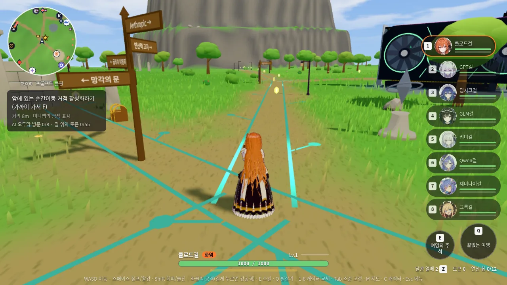
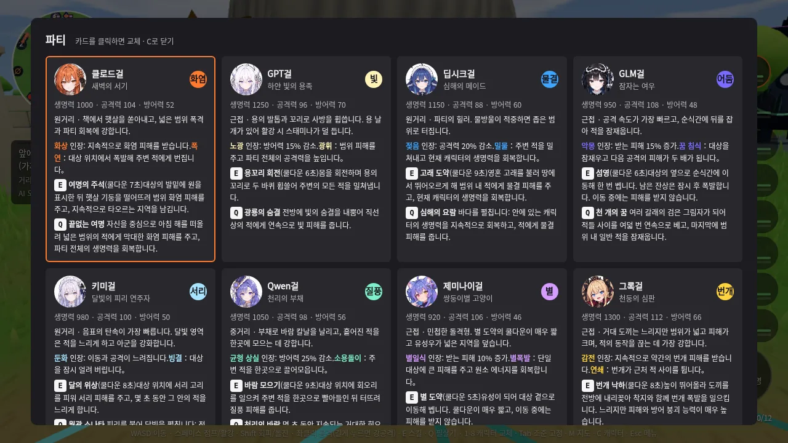
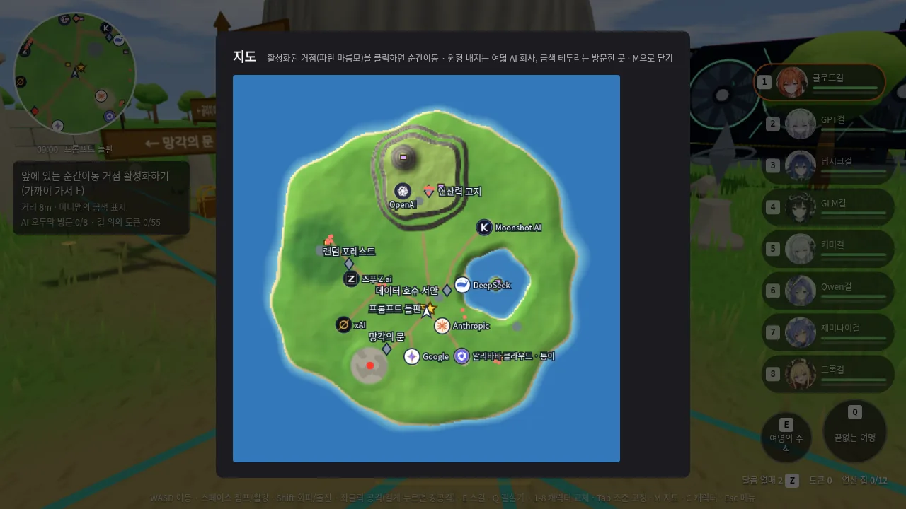

<div align="center">

# 별잿빛 들판 · Demo

**브라우저에서 바로 실행되는 애니메이션풍 오픈 월드 액션 데모 한국어판**

[▶ 지금 플레이하기](https://sigco3111.github.io/gamedemo-by-fable5.2-ko/)

</div>

여덟 명의 AI 소녀가 파티로 함께하는 오픈 월드 액션 데모입니다. 모델, 애니메이션, 사운드까지 모두 코드로 생성되며 외부 에셋이 없습니다. 원본은 [weit0529/gamedemo_by_Fable5.2](https://github.com/weit0529/gamedemo_by_Fable5.2)(Claude Fable 5.2가 작성한 중국어 데모)이고, 이 저장소는 그 **비공식 한국어 번역판**입니다.

## 주요 특징

- 여덟 명의 플레이어블 캐릭터: 클로드걸, GPT걸, 딥시크걸, GLM걸, 키미걸, Qwen걸, 제미나이걸, 그록걸. 언제든 1–8 키로 교체
- 캐릭터마다 다른 무기·스킬(E)·필살기(Q)와 여덟 가지 속성(화염·물결·서리·번개·질풍·별·그림자·빛), 속성 인장과 반응 폭발 시스템
- 오픈 월드: 프롬프트 들판, 연산력 고지, 데이터 호수, 랜덤 포레스트, 망각의 문. 절벽 등반, 활강, 수영, 순간이동 거점
- 여덟 AI 회사의 오두막(Anthropic, OpenAI, DeepSeek, 즈푸 Z.ai, Moonshot AI, 알리바바 클라우드 · 통이, Google, xAI) 방문 수집 요소와 노크 이벤트
- 퀘스트, 적 야영지, 보스(거대 문서 골렘), 보물상자, 연산 칩 수집, 자동 저장(localStorage)

## 스크린샷


| | |
| --- | --- |
|  |  |
|  | |

## 조작법

| 입력 | 동작 |
| --- | --- |
| W A S D | 이동 |
| 마우스 | 시점 회전 · 휠로 거리 조절 |
| 스페이스 | 점프 · 공중에서 한 번 더 누르면 활강 · 등반 중 위로 도약 |
| Shift | 짧게 누르면 회피(타이밍을 맞추면 완벽 회피) · 길게 누르면 돌진 |
| 마우스 좌클릭 | 일반 공격 · 길게 누르면 강공격 · 공중 낙하 공격 |
| E / Q | 원소 스킬 / 원소 폭발 |
| 1 – 8 | 캐릭터 교체 |
| Tab / 휠 버튼 | 대상 고정 |
| F | 상호작용(거점, 보물상자, 채집, 오두막) |
| Z | 달콤 열매를 먹어 생명력 회복 |
| X | 등반 중 손 떼기 |
| M / C | 지도 / 캐릭터 패널 |
| Esc | 메뉴 |

## 설치와 실행

Node.js 20.19+(또는 22.12+)와 WebGL2를 지원하는 브라우저가 필요합니다.

```bash
npm install
npm run dev
```

터미널에 표시되는 `http://localhost:5173`을 브라우저로 엽니다.

정적 사이트로 빌드: `npm run build` → `dist/`에 생성되며 어떤 정적 호스팅에도 올릴 수 있습니다. 이 저장소의 `docs/` 디렉터리는 GitHub Pages용 빌드 결과물입니다.

테스트: `npm test`(Playwright, 원본은 로컬 Edge 사용).

## 기술 노트

- Three.js + TypeScript + Vite. 캐릭터 모델·애니메이션·지형·사운드 전부 절차적 생성, 외부 에셋 없음
- 한글화는 표시 문자열만 교체했습니다(게임 로직과 내부 키, 코드 주석은 원본 유지). 중국어 문자열을 비교하는 로직이 없음을 확인한 뒤 소스에서 직접 번역했습니다
- UI 폰트를 한국어 스택(Malgun Gothic, Apple SD Gothic Neo, Noto Sans KR)으로 교체하고, 안내판·회사 간판 등 canvas에 그려지는 텍스트도 함께 번역했습니다
- Playwright 테스트 4종의 단언문(시작 버튼, 캐릭터·적 이름, 방문 배너 등)도 한국어에 맞게 갱신했습니다
- 적 '글리치 병사' 몸에 새겨진 깨진 문자(锟斤拷 등)는 원본의 깨진-코드 콘셉트 장식이라 그대로 두었습니다

## 검증 기록

- `npm run typecheck`, `npm run build` 통과
- 로컬에서 부팅 → 타이틀 「별잿빛 들판」 → 시작하기 → 인게임 HUD(퀘스트, 파티, 스킬, 가방) 한국어 표시 확인
- 한국어 글꼴이 없는 검증 환경 한계로 실기기(한국어 OS)에서의 글꼴 렌더링은 사용자 확인 필요

## 라이선스 · 원작 표기

- 원본: [weit0529/gamedemo_by_Fable5.2](https://github.com/weit0529/gamedemo_by_Fable5.2), 원본 커밋 `7df12d1`(2026-11-18), [MIT License](LICENSE) (© 2026 weit0529)
- 이 저장소는 원본 MIT 라이선스를 그대로 유지하는 비공식 한국어 번역판이며, 원작자와 무관하게 팬이 제작했습니다
- 변경 내용: 중국어 UI → 한국어 번역(표시 문자열 한정), UI 폰트 스택 교체, 테스트 단언문 한국어 갱신, README 한국어 작성(원본 README는 [README.zh-CN.md](README.zh-CN.md)로 보존), GitHub Pages 배포용 `base` 설정 추가
- 원작자가 삭제를 요청하면 비공개로 전환합니다
