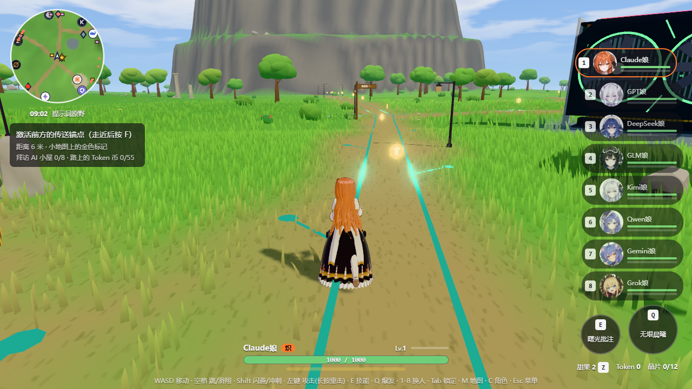
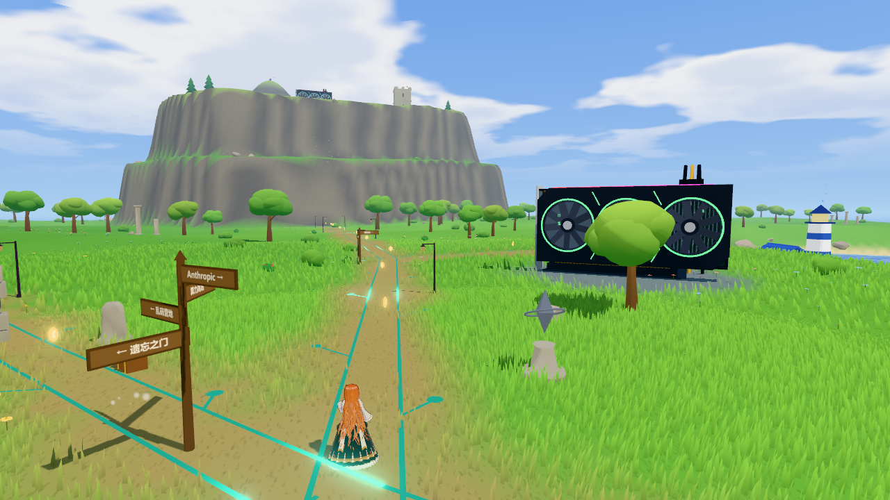
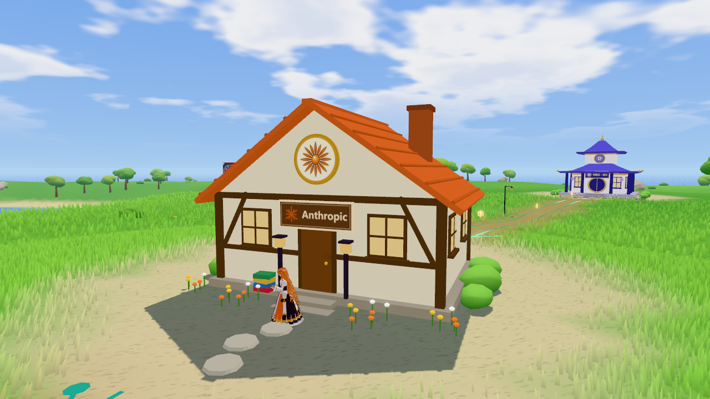
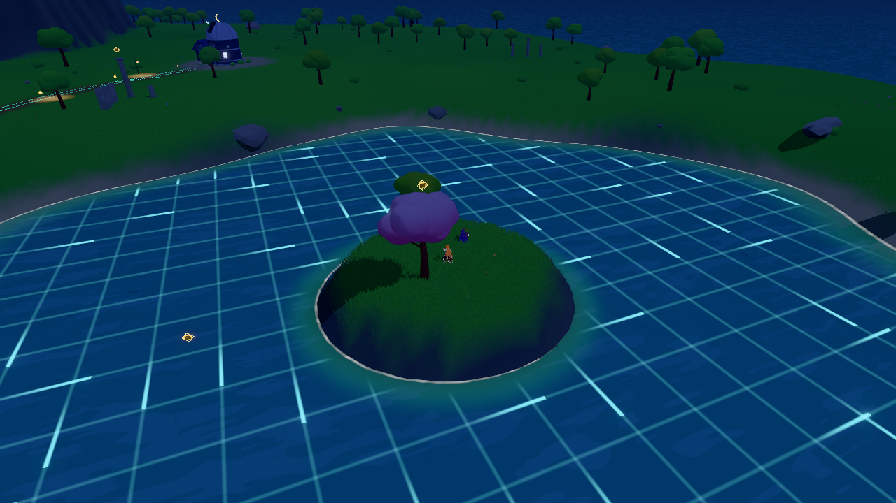
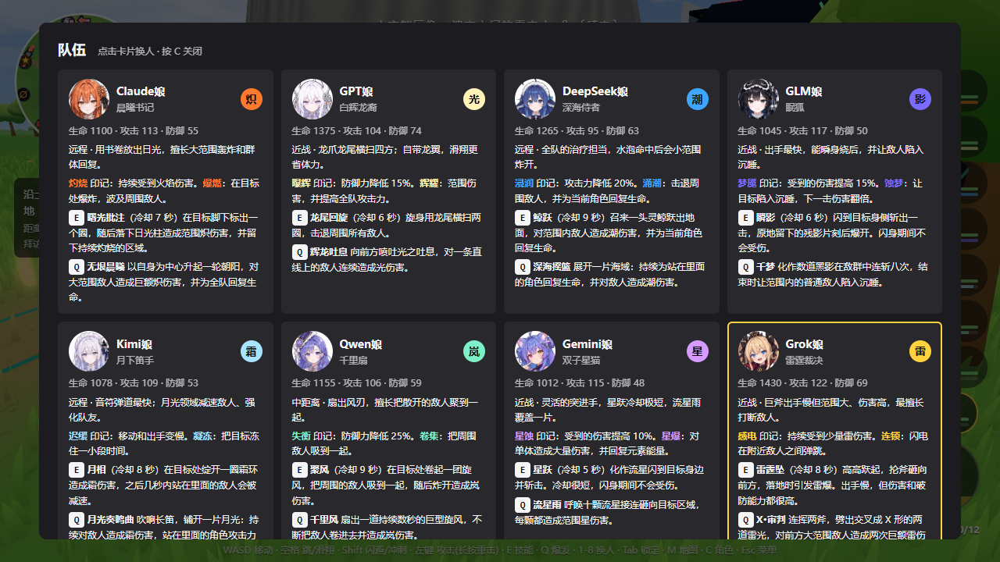

# 星烬原野 · Demo

浏览器里跑的二次元开放世界动作 demo。队伍是 `character/setting/` 里的 8 位 AI 娘，模型、动作、音效全部由代码生成，没有外部素材。代码由 Claude Fable 5.2 编写。



| | |
| --- | --- |
|  |  |
|  |  |

## 怎么跑

需要 Node.js 20.19+（或 22.12+），以及一个支持 WebGL2 的浏览器。

```bash
npm install
```

```bash
npm run dev
```

然后用浏览器打开终端里显示的 `http://localhost:5173`。

打包成静态网页：`npm run build`，产物在 `dist/`，可以放到任意静态托管上。

**在另一台电脑上玩（比如带独显的那台）**：两台机器连同一个局域网，这台保持 `npm run dev` 开着，那台用浏览器打开终端里 `Network:` 那一行的地址（形如 `http://192.168.x.x:5173`）。第一次 Windows 防火墙可能会弹窗，点允许。进游戏后按 Esc，在菜单里把画质切到「精致（独显）」。

## 操作

| 按键 | 作用 |
| --- | --- |
| W A S D | 移动 |
| 鼠标 | 转视角，滚轮拉远近（鼠标没被锁定时，按住右键拖动也能转） |
| 空格 | 跳跃；空中再按一次滑翔；攀爬时向上跃；滑坡时蹬离崖壁 |
| Shift | 点按闪避（敌人出手瞬间闪开会触发「极限闪避」）；按住冲刺 |
| 鼠标左键 | 普通攻击；长按重击；空中按下是下落攻击 |
| E / Q | 元素技能 / 元素爆发（Q 需要攒满能量） |
| 1 – 8 | 切换角色 |
| Tab / 鼠标中键 | 锁定目标 |
| F | 互动：传送锚点、宝箱、采集、拜访小屋 |
| Z | 吃甜果回血 |
| X | 攀爬时松手 |
| M / C / Esc | 地图（点已激活的锚点传送）/ 角色面板 / 菜单 |

攀爬：贴着陡坡或墙按住 W 一小会儿就会爬上去，消耗体力。体力在平地上会自己恢复。

## 世界

一座岛，绕着路走一圈大约十来分钟。五个区域：提示词原野（起点）、数据湖、算力高地、随机森林、遗忘之门。

**八间小屋**：每家 AI 公司一间，屋上挂着自家标志和招牌，路口有路牌指向，地图上用各家自己的标志标出位置（拜访过的套一圈金边）。走到门口按 F 拜访，第一次有奖励；用这家的角色去拜访自己家，元素爆发直接充满；八家都拜访过，体力上限 +30。之后再按 F 是敲门，每家屋里的动静不一样。

| 小屋 | 样子 | 在哪 |
| --- | --- | --- |
| Anthropic | 橙瓦木骨架的书屋 | 起点东南 |
| OpenAI | 白色圆顶屋 | 算力高地顶上 |
| DeepSeek | 蓝色湖畔屋，带灯塔和栈桥 | 数据湖西岸 |
| 智谱 Z.ai | 黑白两层方屋，门口有狐狸石像 | 随机森林东缘 |
| 月之暗面 | 深蓝天文台 | 数据湖北边 |
| 阿里云 · 通义 | 紫瓦金饰的两层楼阁 | 南边 |
| Google | 四色条纹、屋顶带猫耳的工作室 | 西南 |
| xAI | 黑石金饰的尖塔屋 | 西边 |

**路上能看到的东西**

- 土路上铺着两根发光的电路走线，夜里更亮；沿路有路灯，飘着 Token 币，捡一枚 +10 Token。
- 三块插在地里的巨型显卡（风扇会转、会往外吹字符），可以爬上去。
- 随机森林深处有一片机柜遗迹，过道尽头的终端还亮着。
- 起点西边有一棵二叉树。
- 数据湖的水下有一张发光的网格。
- 上升气流里往上飘的是 0 和 1，小屋烟囱里冒的是代码。
- 收集品是算力晶片，每 3 枚加体力上限。

**敌人**

| 敌人 | 样子 | 在哪 |
| --- | --- | --- |
| 乱码兵 | 错位方块拼成的人形，胸口写着「锟斤拷」，头是一个显示不出来的字符 | 各处营地 |
| 电子病毒 | 飘在空中的带刺病毒球，颜色就是它的属性 | 营地、湖畔 |
| 大文档巨像 | 文件夹当胸甲、纸页堆成的巨人，拿一支大红笔，身后拖着打印纸 | 遗忘之门（首领） |

## 八位角色

界面上的头像是从 `character/setting/` 的设定图里裁出来的，八张的脸都在同一个位置。换了设定图以后，改 `tools/make-avatars.py` 里的眼睛坐标再跑一遍就能重新生成。

| 角色 | 属性 | 打法 |
| --- | --- | --- |
| Claude娘 | 炽 | 远程，用书放日光，大范围轰炸加全队回复 |
| GPT娘 | 光 | 近战，龙爪龙尾；自带龙翼，滑翔省一半体力 |
| DeepSeek娘 | 潮 | 远程，治疗担当 |
| GLM娘 | 影 | 近战，出手最快，能瞬身和催眠 |
| Kimi娘 | 霜 | 远程，减速敌人、强化队友 |
| Qwen娘 | 岚 | 中距离，把敌人聚到一起 |
| Gemini娘 | 星 | 近战，突进，流星雨 |
| Grok娘 | 雷 | 近战，巨斧，慢但范围大伤害高 |

**属性反应**：攻击会给敌人挂上本属性的印记；再用另一种属性打它，就按后手的属性触发一次爆发并消耗印记。具体效果在游戏里按 C 看。

## 代码结构

```
src/
  game.ts            主循环，把所有系统接起来
  core/              输入、数学和噪声、画质档、合成音效
  render/            卡通材质和描边、天空昼夜、水、草、特效
  world/             地形高度函数、碰撞、树石遗迹、八间小屋（houses.ts）、AI 摆设（aiprops.ts）、互动物和任务
  char/              骨架和弹簧骨骼、表情贴图、建模零件库、8 位角色、敌人、动作
  player/            移动状态机、相机、队伍、战斗、8 套招式表
  enemy/             敌人 AI 和营地刷新
  ui/                界面和样式
character/setting/   8 位角色的设定图（建模参考，作者 ZipZipPipe，见文末致谢）
docs/                选型记录
```

## 测试

```bash
npm test
```

四个 Playwright 测试（用本机的 Edge）：`smoke` 把主要玩法走一遍，`scene` 检查八间小屋并实际拜访、敲门、捡币，`enemies` 检查头像并给三种敌人拍特写，`portraits` 给角色拍特写。截图存在 `tests/screenshots/`（不进仓库；README 里用的几张在 `docs/screenshots/`）。

调试：地址后面加 `?nolock` 不锁定鼠标；浏览器控制台里有 `game` 对象，`game.step(60)` 可以不等帧回调直接推进 60 帧。

存档在浏览器的 localStorage 里，菜单里可以重置。

## 致谢

八位角色的设定图出自 B 站 UP 主 **ZipZipPipe**，游戏里的角色模型照着这些设定图用代码搭出来，界面上的头像（`public/avatars/`）也是从设定图里裁出来的。感谢原作者。

## 免责声明

- 本项目是开源、非营利的同人 demo，仅供学习和交流，不用于任何商业用途。
- 游戏中出现的 Anthropic、OpenAI、DeepSeek、智谱、月之暗面、阿里云、Google、xAI 等名称和标志是各自公司的商标，归其所有者所有。本项目与这些公司没有任何关联，也未获得其认可或赞助。
- `character/setting/` 里的设定图及由它裁出的头像版权归原作者 ZipZipPipe 所有，不在本项目的开源许可范围内。如需转载或另作他用，请先取得原作者许可。
- 如果有权利人认为本项目的内容侵犯了其权益，请提 Issue 联系，会尽快处理或删除。

## 许可证

代码以 [MIT 许可证](LICENSE) 开源。上面提到的角色设定图、头像和各公司商标不适用该许可证。
